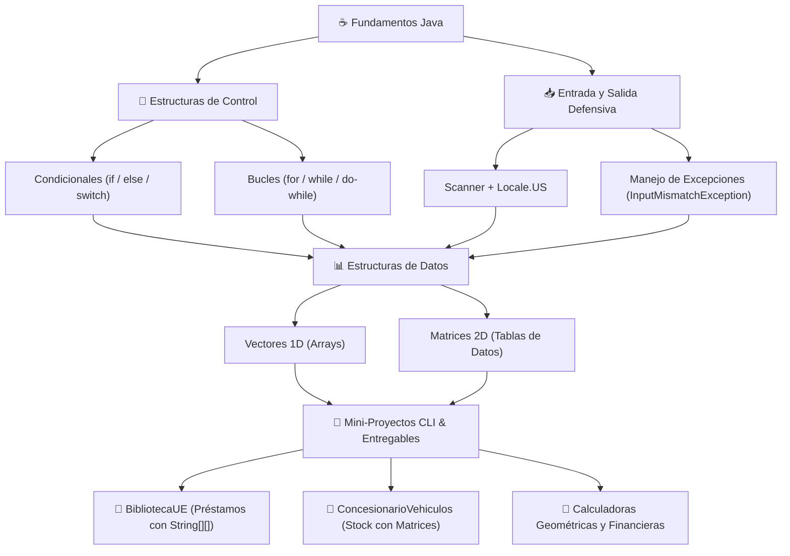

<div align="center">

# ☕ Java Core & Algoritmia Básica

[](https://www.oracle.com/java/)
[](https://www.jetbrains.com/idea/)
[](https://universidadeuropea.com/)
[](#-catálogo-completo-de-ejercicios)
[](#)

<p align="center">
  <strong>Colección integral de ejercicios prácticos, algoritmos fundamentales y proyectos de consola en Java.</strong><br>
  Desarrollados durante el primer curso del ciclo formativo <strong>Desarrollo de Aplicaciones Multiplataforma (DAM)</strong>.
</p>

[📚 Temáticas Cubiertas](#-temáticas-cubiertas) •
[📂 Catálogo de Ejercicios](#-catálogo-completo-de-ejercicios) •
[🏛️ Mapa Conceptual](#-mapa-conceptual-de-aprendizaje) •
[🚀 Cómo Ejecutar](#-cómo-ejecutar-los-ejercicios) •
[👥 Créditos](#-autores-y-créditos)

</div>

---

## 📌 Descripción del Repositorio

Este repositorio reúne las prácticas de laboratorio, actividades entregables y pruebas evaluables de programación estructurada en **Java**. El código recorre desde los fundamentos sintácticos del lenguaje (operadores, lectura de consola y condicionales) hasta el manejo avanzado de **matrices bidimensionales**, diseño de **menús interactivos CLI** y **programación defensiva** mediante control de excepciones (`InputMismatchException`).

---

## 📚 Temáticas Cubiertas

1. **Sintaxis y Control de Flujo:** Operadores aritméticos y relacionales, estructuras `if-else`, operador ternario y `switch-case`.
2. **Bucles e Iteración:** Sentencias `for`, `while` y `do-while`, contadores, acumuladores y algoritmos de parada.
3. **Estructuras de Datos Estáticas:** Vectores unidimensionales (`int[]`, `String[]`), ordenamiento básico, búsqueda de extremos y matrices bidimensionales (`int[][]`, `String[][]`).
4. **Programación Defensiva:** Validación de flujos de entrada con `Scanner`, internacionalización con `Locale.US` y captura de errores de tipo con bloques `try-catch`.
5. **Mini-Sistemas CLI:** Aplicaciones interactivas por consola con persistencia en memoria estructurada (concesionario de coches, biblioteca universitaria, calculadoras geométricas).

---

## 🏛️ Mapa Conceptual de Aprendizaje



---

## 📂 Catálogo Completo de Ejercicios

Todos los programas se encuentran en el directorio `src/` como clases independientes con su propio método `main`:

### 1. 🧮 Fundamentos, Paridad y Cálculos Financieros

| Archivo | Conceptos Clave | Descripción |
| :--- | :--- | :--- |
| [`primerEjemplo.java`](src/primerEjemplo.java) | `Scanner`, variables primitivas | Lectura básica por teclado e impresión por consola. |
| [`ParImpar_basico.java`](src/ParImpar_basico.java) | Operador módulo (`%`), `if-else` | Verificación de números pares o impares. |
| [`ParoImpar.java`](src/ParoImpar.java) | Validación condicional | Versión alternativa con control de entrada de enteros. |
| [`CalculadoraIvaBasic.java`](src/CalculadoraIvaBasic.java) | Aritmética decimal, `Locale` | Cálculo básico de IVA y precio bruto a neto. |
| [`CalculadoraIva.java`](src/CalculadoraIva.java) | `try-catch`, tipos de IVA (21%, 10%, 4%) | Desglose de factura con selección de IVA y control defensivo de errores. |
| [`SueldoTrabajadorBasico.java`](src/SueldoTrabajadorBasico.java) | Tarifas y cómputo de horas | Cálculo del salario base en función de horas ordinarias. |
| [`SueldoTrabajador.java`](src/SueldoTrabajador.java) | Horas extras, deducciones | Simulación de nómina laboral con recargo por horas extras y retenciones. |

### 2. 🔄 Estructuras Repetitivas (Bucles)

| Archivo | Conceptos Clave | Descripción |
| :--- | :--- | :--- |
| [`ejercicioBucle1.java`](src/ejercicioBucle1.java) | Sentencia `for` | Secuencia incremental simple. |
| [`ejercicioBucle2.java`](src/ejercicioBucle2.java) | Bucle `while` | Iteración controlada por condición de parada. |
| [`ejercicioBucle3.java`](src/ejercicioBucle3.java) | Recorridos numéricos | Generación de listas y rangos de enteros. |
| [`ejercicioBucle4.java`](src/ejercicioBucle4.java) | Intervalos y saltos | Conteo con pasos específicos (múltiplos y secuencias). |

### 3. 📊 Arrays Unidimensionales y Álgebra de Matrices

| Archivo | Conceptos Clave | Descripción |
| :--- | :--- | :--- |
| [`ArrayEjercicio1.java`](src/ArrayEjercicio1.java) | `int[]`, recorrido lineal | Llenado de vector por teclado y búsqueda de valores extremos. |
| [`ArrayEjercicio2.java`](src/ArrayEjercicio2.java) | Acumuladores, media aritmética | Cálculo de promedios, elementos sobre la media y formateo con `Locale`. |
| [`ArrayEjercicio3.java`](src/ArrayEjercicio3.java) | Inversión y ordenación | Manipulación y transformación de vectores. |
| [`Matrizx3.java`](src/Matrizx3.java) | Matriz 2D `int[3][3]` | Declaración, carga y visualización de matriz cuadrada 3x3. |
| [`Matrizx5.java`](src/Matrizx5.java) | `java.util.Random`, `int[5][5]` | Generación de matriz 5x5 con datos pseudoaleatorios y búsqueda. |
| [`SumaMatrices.java`](src/SumaMatrices.java) | Álgebra matricial | Operación de suma matricial $C_{ij} = A_{ij} + B_{ij}$ con validación de dimensiones. |

### 4. 🏢 Mini-Sistemas de Gestión y Menús CLI

| Archivo | Conceptos Clave | Descripción |
| :--- | :--- | :--- |
| [`BibliotecaUE.java`](src/BibliotecaUE.java) | `String[100][5]`, `printf` tabular | **Sistema de Biblioteca Universitaria:** Registro de libros, categorías, disponibilidad y asignación de préstamos por DNI. |
| [`ConcesionarioVehiculos.java`](src/ConcesionarioVehiculos.java) | Matrices bidimensionales | Gestión de stock de vehículos, búsqueda por marca/modelo y catálogo de precios. |
| [`ConsecionarioCochesBi.java`](src/ConsecionarioCochesBi.java) | Tablas bidimensionales | Variante optimizada para gestión de vehículos por categorías. |
| [`Demo1ConcesionarioVehiculos.java`](src/Demo1ConcesionarioVehiculos.java) | Menú interactivo completo | Demo integral con operaciones CRUD básicas en memoria de concesionario. |
| [`ProgramaMenu.java`](src/ProgramaMenu.java) | `do-while`, `switch-case` | Plantilla de menú modular con subopciones y salida controlada. |
| [`ejecicioMenu.java`](src/ejecicioMenu.java) | Manejo de opciones | Estructura compacta para navegación de opciones en terminal. |

### 5. 📝 Actividades Entregables y Evaluables (Universidad Europea)

| Archivo | Conceptos Clave | Descripción |
| :--- | :--- | :--- |
| [`ActividadEntregable.java`](src/ActividadEntregable.java) | Geometría, modularidad, `try-catch` | **Calculadora Geométrica:** Áreas y perímetros de círculos, cuadrados, triángulos y rectángulos con validación robusta. |
| [`ActividadEntregableSimple.java`](src/ActividadEntregableSimple.java) | Métodos matemáticos | Versión condensada de la calculadora de figuras geométricas. |
| [`ActividaEvaluable.java`](src/ActividaEvaluable.java) | Evaluación continua | Resolución práctica de examen de programación estructurada. |
| [`Ejercicio1Entregable.java`](src/Ejercicio1Entregable.java) | Validación de Strings y rangos | Sistema de lectura de notas y nombres de alumnos con validación de vacíos. |
| [`ejercicio2Entregable.java`](src/ejercicio2Entregable.java) | Operaciones con reglas | Calculadora con reglas específicas (swap automático si $b > a$, control de división por cero). |
| [`ejercicio3Entregable.java`](src/ejercicio3Entregable.java) | Comparadores condicionales | Algoritmo de comparación para determinar el número mayor y menor. |
| [`ejercicio4Entregable.java`](src/ejercicio4Entregable.java) | Algoritmo de ordenación | Clasificación de tres números (mayor, medio, menor) en orden descendente. |
| [`ejercicio5Entregable.java`](src/ejercicio5Entregable.java) | Lógica booleana | Identificación interactiva de paridad de números enteros. |
| [`ejercicio6Entregable.java`](src/ejercicio6Entregable.java) | Baremos académicos | Conversión de notas numéricas (0-10) a calificaciones oficiales (Suspenso, Aprobado, Notable, Sobresaliente, Matrícula). |

---

## 🛠️ Tecnologías y Entorno

- **Lenguaje:** Java Standard Edition (JDK 8 / 11 / 17 / 21)
- **IDE Recomendado:** IntelliJ IDEA / Eclipse / VS Code
- **Control de Versiones:** Git & GitHub
- **Librerías Estándar Utilizadas:**
  - `java.util.Scanner` — Lectura interactiva de consola.
  - `java.util.Locale` — Configuración de punto/coma decimal (`Locale.US`).
  - `java.util.InputMismatchException` — Captura defensiva de errores de formato.
  - `java.util.Random` — Generación de valores numéricos para matrices.

---

## 🚀 Cómo Ejecutar los Ejercicios

### Opción 1: Desde IntelliJ IDEA (Recomendado)
1. Clona el repositorio:
   ```bash
   git clone https://github.com/Luaz2021/java-ejercicios.git
   ```
2. Abre la carpeta del proyecto en **IntelliJ IDEA**.
3. El archivo de proyecto `.iml` configurará la carpeta `src/` automáticamente como carpeta de código fuente (*Sources Root*).
4. Abre cualquiera de los archivos `.java` dentro de `src/` y haz clic en el botón verde **Run** (o pulsa `Shift + F10`).

### Opción 2: Desde Terminal (javac / java)
Puedes compilar y ejecutar cualquier ejercicio directamente desde la línea de comandos:

```bash
# Entrar a la carpeta de código fuente
cd java-ejercicios/src

# Compilar un ejercicio (ejemplo: BibliotecaUE)
javac BibliotecaUE.java

# Ejecutar la clase compilada
java BibliotecaUE
```

---

## 👥 Autores y Créditos

* **Alexander Martínez ([@Luaz2021](https://github.com/Luaz2021))** — *Autor y Desarrollador*
* Proyecto académico del ciclo formativo **DAM (Desarrollo de Aplicaciones Multiplataforma)** · *Universidad Europea*
* Documentación, diagramación y diseño: **Nova ✨**

---
<div align="center">
  <sub>Repositorio educativo de libre consulta para estudiantes de DAM / DAW · 2026</sub>
</div>
